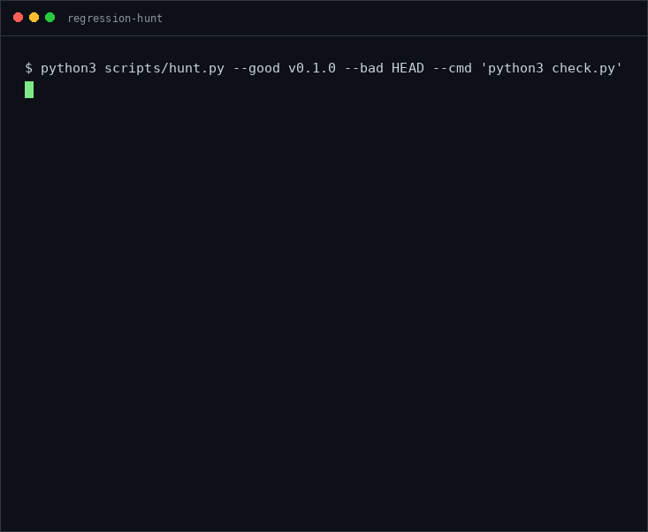
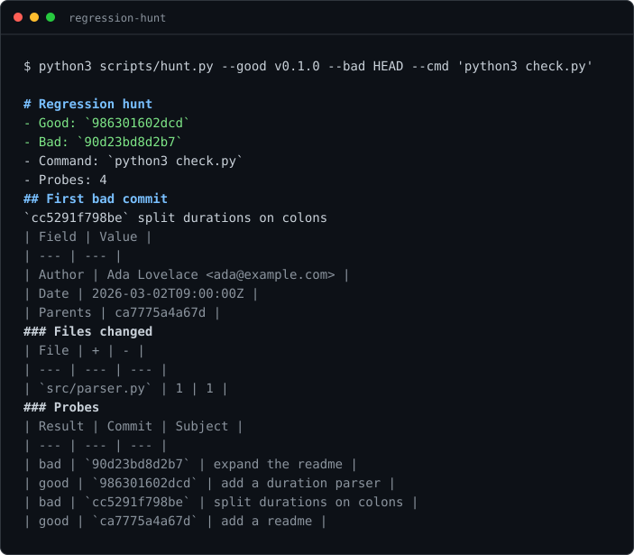
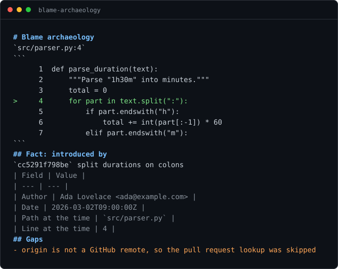
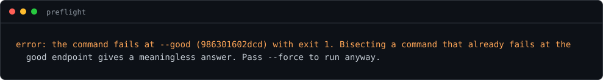
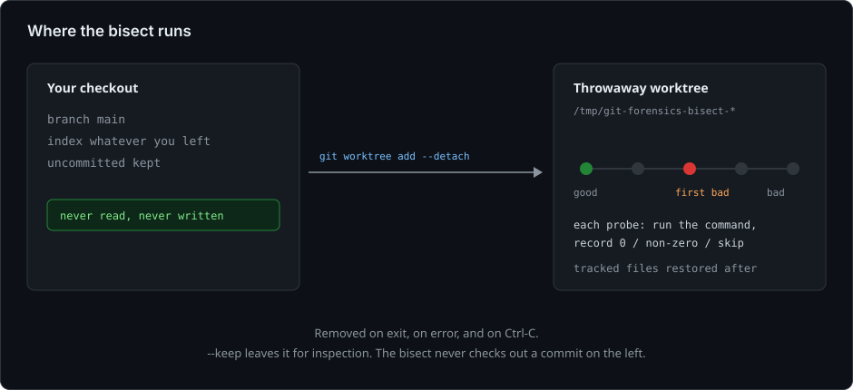

# git-forensics

Two questions git does not answer directly. Two agent skills that do.

| Skill | Question | Guarantee |
| --- | --- | --- |
| `regression-hunt` | When did this break? | Bisects in a throwaway worktree. Your checkout is never touched. |
| `blame-archaeology` | Why does this line exist? | Traces the line to its commit and, when available, the pull request behind it. Labels what it could not find. |

Neither skill guesses. When the evidence runs out, they say so.



## The problem

Agents are good at reading code and bad at two specific things.

**Bisecting.** `git bisect` checks out commits in your working tree, so
uncommitted changes either block the checkout or are stranded when the run ends.
If a probe hangs or the agent loses track, the repository stays mid-bisect and
the next command runs against whatever commit is checked out.

**Explaining history.** Asked why a line exists, an agent will produce a
confident paragraph about intent that no commit supports. The commit subject says
"refactor"; the agent says "to fix a race condition". That is fabrication with a
straight face.

Both problems have the same shape: the correct method is mechanical and tedious,
and the failure mode is a plausible invention. So the method lives in a script,
and the invention is structurally prevented.

## What it looks like

A parser regresses between `v0.1.0` and `HEAD`. One command finds the commit:



The other skill answers the other question, and refuses to overreach:



And when the command cannot answer the question at all, it says so before
spending ten minutes:



Every section is either `Fact` (read from git) or `Inference` (an association
that may be wrong). `Gaps` is not a failure state; it is the answer being honest.

## How they stay safe



**`regression-hunt` never touches your checkout.** It runs
`git worktree add --detach` into a temp directory and bisects there. Your
branch, index, and uncommitted changes are not read. The worktree is removed on
exit, on error, and on Ctrl-C. `--keep` leaves it for inspection.

**It refuses a range that cannot answer the question.** Before bisecting, it
runs your command at both endpoints. If the command passes at `--bad`, there is
no failure to find. If it fails at `--good`, the answer would be meaningless.
Both cases stop with exit 4 instead of producing a confident wrong commit.

**Timeouts and signals are skips, not verdicts.** A probe that exceeds
`--timeout`, or one killed by a signal, is reported to git as skip (125). It
never gets counted as "good" or "bad".

**A build step cannot break the run.** Tracked files are restored after each
probe, so a formatter or a compiler writing into the tree does not block the
next checkout.

**`blame-archaeology` only reads.** It runs `git blame`, `git show`, `git log`,
and one `GET` through `gh api`. It has no write path.

## Install

Any client that discovers `skills/<name>/SKILL.md` works: Claude Code, Codex,
Cursor, Gemini CLI, Devin, OpenCode.

```sh
# copy one or both into your client's skills directory
cp -r skills/regression-hunt ~/.claude/skills/
cp -r skills/blame-archaeology ~/.devin/skills/
```

Or, if you use the skills CLI:

```sh
npx skills add vezeqs/git-forensics
```

Requirements: `git` 2.20 or newer, Python 3.9 or newer, and a POSIX shell for
the command you bisect. No third-party packages. `gh` is optional and only used
for pull request lookups.

## Exit codes

Both scripts use the same convention, so a caller can branch on them.

| Code | `regression-hunt` | `blame-archaeology` |
| --- | --- | --- |
| 0 | First bad commit found | History found |
| 1 | Unexpected failure | Unexpected failure |
| 2 | No verdict | Line is uncommitted |
| 3 | Interrupted | — |
| 4 | Usage or preflight failure | Bad path, bad line, or not a repository |

`--json` prints a versioned schema. See
[regression-hunt/references/report-format.md](skills/regression-hunt/references/report-format.md)
and
[blame-archaeology/references/report-format.md](skills/blame-archaeology/references/report-format.md).

## What is not covered

- **Flaky tests.** Bisect assumes a stable answer per commit. A flaky command
  produces a confident, wrong commit. Quarantine the test first.
- **Shallow clones.** The range may be incomplete. The tool warns, but cannot
  repair it.
- **Submodules.** They are not initialized in the worktree, so a command that
  needs them fails at both endpoints and the preflight refuses the range.
- **Squashed history.** If the repository was imported as one commit, there is
  no archaeology to do. The skill reports a gap rather than reconstructing a
  plausible past.
- **Merge attribution.** Blame follows a line into one parent. A change made
  while resolving a conflict is attributed to the merge, which the report names.

## Reproduce this

Every image above comes from one script. It builds the repository, breaks the
parser, and runs both skills against it:

```sh
./examples/demo.sh          # the run the README quotes
make assets                 # regenerate docs/ from that run
```

The commit dates are fixed, so the hashes are stable across runs. No network,
no fixtures, nothing left behind.

## Development

```sh
make check     # validator and the full test suite
make test      # tests only
make validate  # SKILL.md conformance only
make assets    # regenerate the images in docs/
```

`make assets` needs Pillow and the DejaVu Sans Mono font:

```sh
python3 -m pip install -r requirements-dev.txt
```

The suite creates real repositories in a temp directory and drives the scripts
as subprocesses. It does not touch the network; the GitHub payload parser is
tested against fixtures.

Layout:

```
skills/<name>/SKILL.md        instructions the agent reads
skills/<name>/scripts/*.py    the mechanical part
skills/<name>/references/     loaded only when needed
tools/validate_skills.py      spec conformance for this repo
tools/render_assets.py        README images, generated from a real run
tests/                        behavioural tests
```

## License

MIT.
